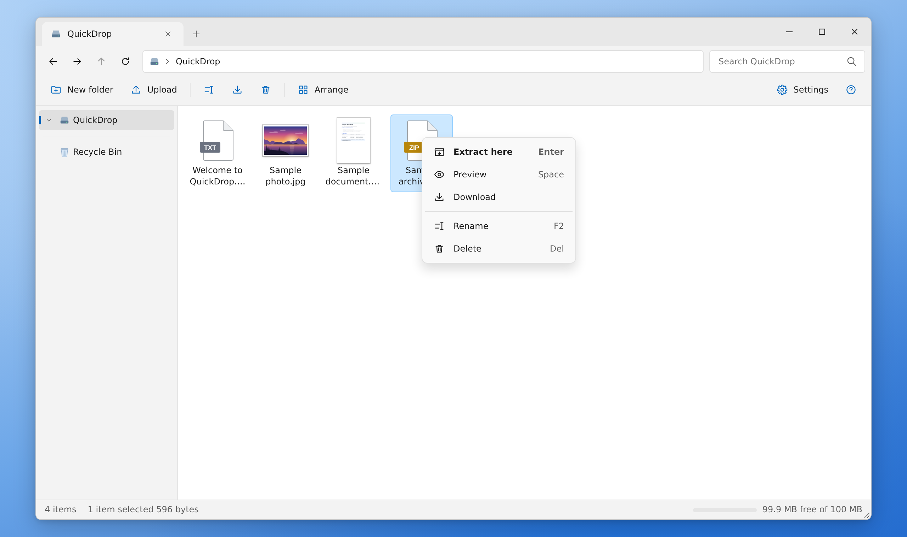

# QuickDrop

A simple shared drop zone for your home network. It looks and works like a Windows Explorer window in the browser: drag files in from any device, move the icons wherever you like, make folders, and pick the files up again on your phone, laptop or desktop, whatever it runs.



## Features

- Explorer-style window with address bar, folder tree, command bar and status bar
- Drag files, or whole folders, in from your desktop; each one lands where you drop it
- Icons stay where you put them; drag them onto a folder, the folder tree or the address bar to move them
- Drag a file out onto your desktop or into a file manager to save it there (Chrome and Edge)
- Live sync: open QuickDrop on several devices and every change shows up instantly everywhere
- Right-click menus, rename in place, box selection, Ctrl/Shift selection and the usual keyboard shortcuts
- Recycle Bin: deleted items can be restored, Ctrl+Z undoes the last delete, Shift+Del deletes for good
- Built-in help (F1)
- A new install starts with four sample files to try things on
- Thumbnails for images, video and PDF
- A storage quota (100 MB by default) shown as a drive bar in the status bar
- Upload button for phones and tablets, which can't drag and drop
- Follows the system light/dark theme and works full screen on small screens

## Modules

QuickDrop on its own is just the Explorer window: double-click downloads a file. Everything else is a module you switch on or off under **Settings**. The setting is shared by every device.

| Module | What it adds |
| --- | --- |
| Preview | Double-click opens a viewer for photos, video, audio, PDF and text, with arrow keys to step through the folder |
| Zip | "Compress to ZIP file" for any selection, and double-click a .zip to extract it next to the archive. Optional password: AES-256 (opens with 7-Zip) or ZipCrypto (opens in Windows Explorer). Runs in your browser |
| Notepad | Edit text files; adds "New text document" to the right-click menu |
| Paint | Draw on and edit PNG, JPEG, WebP, GIF and BMP images; pencil, brush, eraser, fill, shapes, color picker, rotate, flip and resize. Adds "New image" |
| Convert | Right-click > Convert to: images (PNG, JPG, WEBP, GIF, BMP, AVIF; HEIC in Safari) to JPG, PNG, WEBP or PDF, several images into one PDF, PDF pages to PNG, and audio, or the sound of a video, to MP3 or WAV. Runs in your browser; nothing to install |

## Installation

### Docker

```bash
git clone https://github.com/yonie/quickdrop
cd quickdrop
docker compose up -d --build
```

QuickDrop is then on port 3030 and keeps its files in `./data`. The image is about 18 MB: Alpine plus one program. To change that, create a `.env` next to `docker-compose.yml`:

```bash
QUICKDROP_DATA=/srv/quickdrop
QUICKDROP_PORT=3030
QUICKDROP_QUOTA_MB=100
QUICKDROP_HOSTS=drop.example.com
```

`QUICKDROP_HOSTS` is only needed when you open QuickDrop under a full domain name, for example behind a reverse proxy. Addresses like `192.168.1.10`, `localhost`, a plain machine name and names ending in `.local`, `.lan`, `.home.arpa` or `.internal` always work.

### Without Docker

QuickDrop is a single program with the web app built in. Build it with [Go](https://go.dev) 1.25 or newer, then run it:

```bash
go build -o quickdrop .
./quickdrop
```

Go can build it for another system from any machine, for example `GOOS=windows GOARCH=amd64 go build -o quickdrop.exe .` or `GOOS=darwin GOARCH=arm64 go build -o quickdrop .` Copy that one file over and run it; nothing else needs to be installed.

| Variable | Default | Meaning |
| --- | --- | --- |
| `PORT` | `3030` | Port to listen on |
| `DATA_DIR` | `data` | Where files and the index are stored |
| `QUOTA_MB` | `100` | Total storage allowed |
| `ALLOWED_HOSTS` | | Comma-separated domain names QuickDrop may be opened under, besides addresses and home-network names. `*` allows any name |
| `SAMPLES` | `1` | Set to `0` to start a new install empty instead of with four sample files |

## Security

There is no login. Anyone who can reach QuickDrop can read, change and delete everything in it. Run it on a network you trust, or put it behind a reverse proxy that only lets your own devices in (for example an nginx `allow`/`deny` list for your LAN and VPN ranges).

What is built in:

- Other websites you visit can't make changes in QuickDrop: requests from another origin are refused, and the API only accepts JSON.
- Other websites can't reach it through DNS rebinding either: QuickDrop only answers to addresses, home-network names and the names in `ALLOWED_HOSTS`.
- A strict Content Security Policy: the page only runs QuickDrop's own code.
- Uploaded files are served sandboxed, so an uploaded HTML or SVG file can't run script as QuickDrop.
- The quota is enforced on the server, including for uploads running at the same time, and QuickDrop holds at most 10,000 files and folders.
- File names can't contain invisible or direction-changing characters, so a program can't be disguised with a fake extension such as `photo[RLO]gpj.exe` showing as `photoexe.jpg`.
- The server uses only Go's standard library, no third-party code. The Docker container runs as a normal user, with a read-only file system apart from its data folder and no Linux capabilities.

## Usage

| Action | How |
| --- | --- |
| Add files | Drag them onto the window, or the Upload button |
| Open a folder / file | Double-click, or Enter |
| Preview a file | Space |
| Move icons | Drag them; drop onto a folder to move them inside |
| Select several | Drag a box on empty space, Ctrl+click, Ctrl+A |
| Rename | F2 or right-click > Rename |
| Delete | Del or right-click > Delete (goes to the Recycle Bin) |
| Undo delete | Ctrl+Z |
| Delete permanently | Shift+Del, or Delete inside the Recycle Bin |
| New folder | Ctrl+Shift+N or right-click on empty space |
| Back / Forward / Up | Alt+Left, Alt+Right, Alt+Up or Backspace |
| Search this folder | Ctrl+F |
| Refresh | F5 |
| Help | F1 |

## Writing a module

A module is a folder in `modules/`. Modules run in the browser; the server only stores files. Modules are built into the program, so rebuild after adding one.

```
modules/hello/
  module.json   { "name": "Hello", "description": "…", "icon": "eye", "order": 50 }
  client.js     export default function (host) { return { …hooks } }
  client.css    optional
```

`client.js` returns any of these hooks:

- `defaultAction(item)`: return `{ label, icon, run }` to handle double-click for that item
- `itemMenu(items)`: extra right-click entries for the selection (`group: 'send'` puts them below Download)
- `newMenu(pos)`: entries for the right-click menu on empty space
- `onKey(event)`: return `true` when the module handled the key
- `onState()`, `enable()`, `disable()`: lifecycle
- `api`: functions other modules may call through `host.module(id)`

`host` gives modules the state, dialogs (`host.form`, `host.alert`), app windows (`host.openWindow`), `host.createFile` and `host.saveFile`, and the menu and selection helpers; see `public/app.js`.

## License

MIT License

QuickDrop uses these libraries, unmodified, under their own licenses. The browser libraries are in `public/vendor`; `scripts/update-vendor.sh` refreshes them.

| Library | Used for | License |
| --- | --- | --- |
| [Go standard library](https://go.dev) | the server | BSD-3-Clause |
| [zip.js](https://gildas-lormeau.github.io/zip.js/) | Zip module | BSD-3-Clause |
| [PDF.js](https://mozilla.github.io/pdf.js/) | PDF thumbnails, preview, PDF to PNG | Apache-2.0 |
| [lamejs](https://github.com/BreezyStack/lamejs) | MP3 encoding in the Convert module | LGPL-3.0 |
